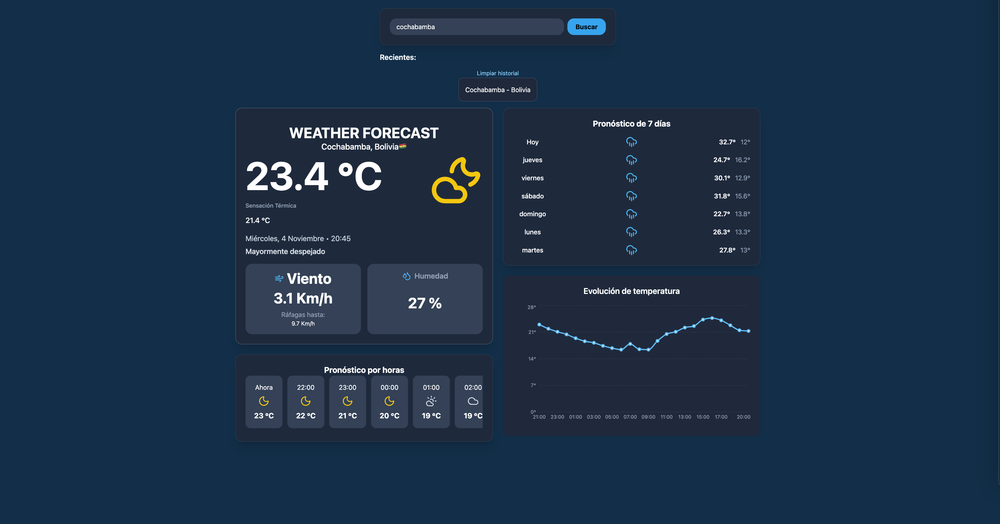

# 🌤️ Weather In Motion

**Aplicación web de pronóstico meteorológico desarrollada con React, TypeScript y Tailwind CSS.**

Weather In Motion permite consultar las condiciones meteorológicas actuales y los pronósticos de distintas ciudades, mediante una interfaz moderna, intuitiva y adaptable a dispositivos móviles.

🌐 **Demo en vivo:** https://weather-in-motion-kappa.vercel.app/

📦 **Repositorio:** https://github.com/diegolealirrazabal1891-boop/weather-in-motion

---

## 📸 Vista previa



## ✨ Funcionalidades

- 🔍 Búsqueda de ciudades mediante geolocalización por nombre.
- 🌡️ Consulta de temperatura actual y sensación térmica.
- 💨 Información sobre velocidad del viento y humedad.
- 🕒 Pronóstico meteorológico para las próximas 24 horas.
- 📅 Pronóstico extendido de 7 días.
- 📊 Gráfico interactivo de temperaturas.
- 🌙 Iconos meteorológicos adaptados a las condiciones del día y la noche.
- 🕘 Historial de ciudades consultadas.
- ⭐ Registro de ciudades frecuentes.
- 💾 Persistencia de datos mediante LocalStorage.
- 📱 Diseño responsive para diferentes dispositivos.
- ⚠️ Manejo de errores y situaciones sin resultados.

## 🛠️ Tecnologías utilizadas

- **React** – Construcción de interfaces.
- **TypeScript** – Tipado estático.
- **Tailwind CSS** – Diseño y estilos.
- **Vite** – Herramienta de desarrollo y compilación.
- **Recharts** – Visualización de datos mediante gráficos.
- **Lucide React** – Iconografía.
- **Open-Meteo API** – Datos meteorológicos y búsqueda de ciudades.
- **LocalStorage** – Persistencia de información en el navegador.

## 🚀 Instalación y ejecución

Si deseas ejecutar el proyecto localmente:

1. Clona el repositorio:

```bash
git clone https://github.com/diegolealirrazabal1891-boop/weather-in-motion.git
```

2. Accede a la carpeta:

```bash
cd weather-in-motion
```

3. Instala las dependencias:

```bash
npm install
```

4. Inicia el servidor de desarrollo:

```bash
npm run dev
```

5. Abre en tu navegador la dirección indicada por Vite.

## 🏗️ Compilación para producción

Para generar la versión de producción:

```bash
npm run build
```

Para probar la compilación localmente:

```bash
npm run preview
```

## 🌐 API utilizada

Este proyecto utiliza [Open-Meteo](https://open-meteo.com/), un servicio que proporciona información meteorológica y datos de geolocalización.

## 👨‍💻 Autor

**Diego Leal**

Desarrollador web en formación, enfocado en el aprendizaje y desarrollo de aplicaciones utilizando tecnologías modernas del ecosistema JavaScript.

[GitHub](https://github.com/diegolealirrazabal1891-boop)

---

*Proyecto desarrollado con fines de aprendizaje y práctica de desarrollo web.*